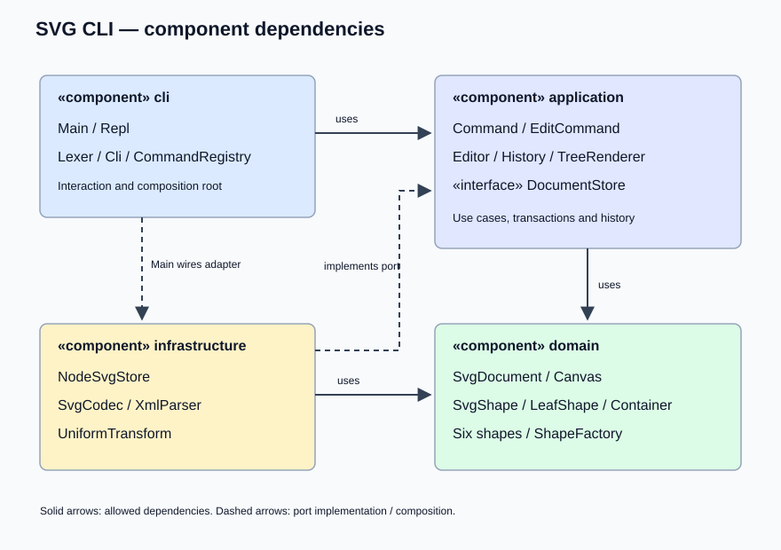
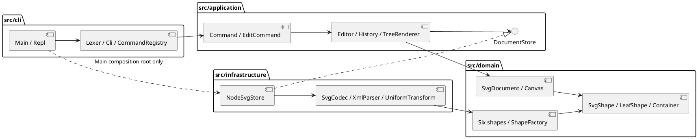

# Lab1 Phase 1：SVG 编辑器（CLI）

本工程覆盖本阶段六种图形和全部命令；不实现后续插件阶段的 `box`。运行、依赖安装及回放入口见工程根目录 `README.md`。

## 架构方案

### 1. 模块划分

| 模块 | 主要类 / 文件 | 职责 |
|---|---|---|
| `src/domain/` | `SvgShape`、`LeafShape`、`Container`、`Rect/Circle/Ellipse/Line/Text/Group` | 图形行为、几何与属性校验、组合树 |
| `src/domain/` | `SvgDocument`、`Canvas`、`ShapeFactory`、`NumericAttributes`、`Validation` | 画布、id 唯一性、父子关系和层级编辑、图形构造 |
| `src/application/` | `Command`、`EditCommand` 及具体命令 | 将每条用户操作封装为对象；解析参数和执行用例 |
| `src/application/` | `Editor`、`History` | 当前文档与路径、事务提交、undo/redo 和 IO 屏障 |
| `src/application/` | `DocumentStore`、`LoadedDocument` | 存储端口及成功读入的文档与警告 |
| `src/application/` | `Arguments`、`TreeRenderer`、`CommandCatalog` | 参数、结构树/属性显示及帮助目录接口 |
| `src/infrastructure/` | `NodeSvgStore`、`SvgCodec`、`XmlParser`、`XmlElement`、`UniformTransform` | 文件系统、XML 解析与转义、SVG 编解码和导入变换归一化 |
| `src/cli/` | `Lexer`、`ParsedLine`、`CommandRegistry`、`Cli`、`Repl` | 分词、命令分发、统一错误输出、逐行 REPL |
| `src/cli/Main.ts` | 组合入口 | 注入实际存储实现并启动 REPL |
| `test/`、`scripts/`、`examples/` | 自动测试、架构检查、回放资料 | 质量验证与复现 |

每个实现类一个同名文件；接口单独存放。数值、样式、文本、子节点、历史栈均通过私有/受保护字段和行为方法管理。图形不是公共数据袋，容器不是一组外部过程式函数。

下图表示组件和依赖。配图与 PlantUML 源码表达相同分层；源码可在 PlantUML 工具中渲染完整组件图。



[完整 PlantUML 文件](architecture.puml)：



### 2. 设计模式的选择与落地

**Command（题目强制）**：`Command` 规定执行契约，每条命令有独立实现。`CreateCommand`、`MoveCommand`、`GroupCommand` 等继承 `EditCommand`；`ReadCommand`、显示命令等继承 `Command`。分发器每次创建新的命令对象，避免历史栈里的不同操作引用同一可变命令实例。

**Memento**：`EditCommand.perform` 复制当前文档，只对工作副本执行具体命令。成功后保存 before/after 快照，`Editor` 才替换文档并记录历史；失败时副本被丢弃。`undo/redo` 返回快照的再复制，防止恢复后的编辑污染历史。这样 `group`、删除整棵子树、递归缩放都只占一个撤销单元。代价是每条编辑约保存两份完整文档，适合本阶段小型画布；大型文档未来可替换为差量或结构共享。

**Composite**：`SvgShape` 为统一抽象，`LeafShape` 封装叶子几何，`Container` 递归执行 `move/scale`。`Group` 与叶子采用同一 `set`、定位和删除入口。容器设置 `fill/stroke/stroke-width` 保留为 SVG 继承样式；不会逐个覆盖已有显式样式的子节点。`ungroup` 会将容器上必要的继承属性补到没有覆盖它们的孩子上。

**工厂和依赖倒置**：`ShapeFactory` 为 CLI 创建和 SVG 读入提供统一构造入口；`Editor` 仅依赖 `DocumentStore` 端口，文件系统实现由 `Main` 注入。测试可以使用内存存储替代实际文件。

按名字分派只有两个业务入口：

| 位置 | 当前实现 | 待重构项 |
|---|---|---|
| `cli/CommandRegistry.ts` | 命令名 → 命令类构造器 | 后续增加可注册命令目录和扩展元数据 |
| `domain/ShapeFactory.ts` | 图形类型名 → 图形类构造器 | 后续演进为 ShapeProvider 注册机制、插件生命周期和复合图形恢复 |

这两处本阶段采用固定注册表，**明确记为后续待重构项**。其他图形行为通过多态实现，无 `switch(tag)`。`UniformTransform` 解析 SVG 变换语法属于格式解析，不负责图形类型或命令类型分派。

### 3. 依赖方向规则

1. `domain → domain`：领域规则不得引用 CLI、应用服务、Node IO 或 XML 库。
2. `application → application/domain`：命令与历史可以使用领域模型；存储通过端口调用，不得导入具体基础设施。
3. `infrastructure → infrastructure/application/domain`：适配端口并构造领域对象；只在此层使用文件系统和 `saxes`。
4. `cli → cli/application/domain`：解析并调用用例；`Repl` 可以使用 Node 的 readline/process。**仅组合入口 `Main.ts` 可以引用 infrastructure**，负责依赖注入。
5. 测试可使用所有层；`scripts/` 是检查工具，不是业务模块。业务代码不依赖测试和脚本。

理由：把易变的交互渠道和文件格式放在外围，图形编辑规则能独立测试与复用。依赖检查发现违反规则应视为待处理项，本次自动检查通过后未发现越界依赖。

### 4. 变化点假设

| 可能变化 | 当前准备 / 不预留的原因 |
|---|---|
| 增加 GUI、agent 或其他交互渠道 | 领域和应用不依赖 REPL；可复用命令与 `Editor`，替换参数适配和展示层 |
| 新增图形 / `box` 插件 | 保留多态基类、统一工厂；本阶段不建立插件加载系统，避免提前实现未要求的生命周期与动态依赖 |
| 新的 SVG 属性或高级元素 | XML 解码独立，属性白名单集中在模型；不支持内容明确拒绝，避免读入后悄悄丢失 |
| 更换存储方式 | `DocumentStore` 抽象隔离文件系统，可替换为云端或内存适配器 |
| 图形数量、撤销次数增多 | Command 对外契约不依赖逆操作细节，可替换 Memento 的整文档快照；本阶段接受内存开销 |
| 显示格式变化 | `TreeRenderer` 集中格式化；树行由各类 `describe` 多态生成 |

## 过程记录

以下记录来自本次实际 AI 协作与检查，没有虚构学生与 AI 的对话。用户提供作业文件并要求完成；Codex 负责实现、测试和自查。

| 阶段 | 发现 / 决策 | 确认与修订 |
|---|---|---|
| 需求分析 | `box` 的长篇定义容易被误认为本阶段要求 | 对照 4.4 阶段边界，限定六种内置类型，并测试 `create box` 的未知类型错误 |
| 架构先行 | IO 与历史逻辑容易集中到一个命令解释器 | 先提交架构初稿，后分别提交模型、Command/历史与 CLI/IO |
| 首次类型检查 | 构造函数参数属性不是 Node 原生擦除 TypeScript 支持的语法；工厂 Map 推断过窄 | 严格编译发现后改为显式私有字段，并显式声明构造器 Map 的公共类型；模型测试通过后提交 |
| 撤销设计 | 如果一条命令逐步修改当前树，中途数值溢出会留下半成品 | 改为副本文档事务；测试第二个子图形缩放溢出，确认第一个图形也未发生变化，历史仍可撤销 |
| 外部读入 | 边遍历边分配 `rect1` 可能与文件后面已有的 `rect1` 冲突 | 先扫描并保留全部显式 id，再按类型计数分配；专门测试后出现的显式 id 和大小写差异 |
| 分组语义 | 题目要求保持相对顺序，但没有规定跨父容器的插入位置 | 采用当前树的先序顺序，放到最近公共父容器下，插入到最早关联分支前；对重叠祖先/后代先拒绝 |
| SVG 复核 | 解散分组会丢失继承样式；导入 transform 若只缩放坐标会改变文字和描边的外观 | 为继承样式和导入变换增加多态处理与回归测试；CLI `scale` 仍按题目只改几何属性 |
| 完整回放 | 直接函数调用不足以确认 stdin、提示符和 EOF 行为 | 使用真实 Node 子进程回放命令并保存/读回 SVG；题目典型会话和流程图均生成实际输出 |
| 交付环境 | 本机默认 Git/Node 无法使用 | 使用 Codex 附带运行时完成验证，工程本身使用标准 Node/npm/pnpm 命令，不绑定本机绝对路径 |

### 修订记录

- 初稿四层结构保留；细化了存储端口、参数对象、XML 中间元素和变换归一化类，均落在原有模块内。
- 增加 `normalizeTransform` 区分导入 SVG 变换与 CLI `scale`：前者保持所支持 SVG 的视觉语义，后者遵循题目几何缩放语义。
- 增加 `tsconfig.test.json`，类型检查同时覆盖源码和测试；增加架构自动检查脚本。
- 明确 `group` 插入规则、批处理退出码、帮助命令的文档前可用性等题目未完全指定的边界。

## 一致性自查

### 1. 模块划分是否一致

一致。实际业务代码位于 `domain/application/infrastructure/cli` 四个目录。`test/scripts/examples/doc` 为验证、示例和交付目录；新增细分文件已在上文修订记录说明。全部实现类遵循一类一文件、文件名等于类名，两个接口文件无实现类。

### 2. 依赖方向是否违反方案

自动脚本解析 TypeScript AST 检查所有 import，验证分层、类文件名及禁止的 switch/自由函数声明；它不声称能自动证明所有语义层面的面向对象质量。当前检查覆盖 **53 个源码文件、168 条 import，未发现规则违反**。

抽样人工复核：

- `MoveCommand → EditCommand/Arguments/SvgDocument`，没有 CLI 或文件系统引用。
- `Editor → DocumentStore`，未依赖 `NodeSvgStore` 或 `SvgCodec`。
- `SvgCodec → ShapeFactory/SvgDocument/LoadedDocument`，未依赖 REPL 或命令分发器。
- `Main → Editor/NodeSvgStore/SvgCodec/Cli/Repl`，只负责允许的组合与启动。
- `Rect/Circle/Ellipse/Line/Text/Group` 通过继承实现行为；没有按 tag 分派几何编辑的集中式 switch。

## 质量保证手段

### 功能覆盖

| 要求 | 验证证据 |
|---|---|
| 文档命令 `init/read/save/canvas` | 默认尺寸、尺寸修改、默认保存路径、失败 IO 原子性和历史屏障测试 |
| 六种内置图形 | 所有类型创建、保存读回；几何缩放、移动、属性白名单、默认样式省略测试 |
| `create … in` 和所有组合编辑 | 多层容器、group/ungroup/addto/delete、同级 front/back、父子循环拒绝和整条命令撤销测试 |
| 显示与交互 | tree/show/help、带空格文字与路径、中文、空字符串、转义、注释、统一单行错误和 REPL 子进程测试 |
| undo/redo | 整条编辑一个单元、新编辑清空 redo、显示不入栈、成功 IO 锁定、失败不影响历史测试 |
| SVG 外部文件 | 缺 id 警告、预留显式 id、重复 id 拒绝、XML 转义、格式错误及不支持内容拒绝测试 |
| 题目实例 | `examples/session.cli` 和 `examples/flowchart.cli` 的实际回放输出与 SVG |

### 可重复运行的检查

```sh
npm run verify
# 等价的无 npm 调用（依赖已安装）：
node --run verify
```

`check` 用严格 TypeScript 检查源码与测试，再运行架构脚本；`test` 用 Node 内置测试运行器；`build` 产出标准 JavaScript。当前 **47 项测试全部通过**。验证记录保存在 `doc/verification.txt`。测试包含真实文件和真实 REPL 子进程，不只检查字符串模板。

### 约定与边界

- 帮助、空行和注释可以在新建文档前使用；其他有效业务命令需要当前文档。
- `init [w] [h]` 按顺序使用默认参数；`canvas` 只接受零个或两个参数。
- 根级 `g` 禁止解散，严格遵循题目；普通 `g data-kind="box"` 按普通分组降级，不恢复尚未实现的插件类型。
- `front` 移到同级数组末尾，`back` 移到开头，对应 SVG 后绘制覆盖先绘制的顺序。
- `group` 至少需要一个成员；按现有树的先序顺序收编，重复成员和祖先/后代重叠输入报错。
- 成功 `init/read/save` 和修改尺寸的 `canvas` 会清空并锁定历史。失败不锁定；新编辑之后只能撤销 IO 屏障之后的操作。
- `save` 明确路径成功后更新默认保存路径；`init` 清空路径。保存使用同目录临时文件加 rename，写入失败不破坏已有目标文件；不覆盖符号链接。
- CLI 缩放的是位置与几何尺寸，不缩放 `stroke-width` 或文字字号（后两者不在题目定义的几何属性内）。SVG 导入的正数等比 transform 另行归一化，同时处理继承字号和描边。
- 支持六种元素、基础几何、公共样式、文字内容，以及导入时保留 `font-size/font-family/font-weight/text-anchor/dominant-baseline/data-*`。导入支持 translate 和正数等比 scale；不同等比值、rotate/skew/matrix、高级 SVG 元素/属性明确报错。
- 画布接受数值或 px 尺寸，以及与尺寸一致、原点为零的 viewBox。没有尺寸时优先用 viewBox，否则默认 800×600。不支持任意视口映射、百分比或其他 CSS 单位。
- 不执行脚本、外部实体或 DOCTYPE；不支持的内容拒绝读取，防止无提示损失。
- 批处理遇错仍继续后续行，最终返回退出码 1；交互会话可继续使用。EOF 退出，不额外添加题目外的退出命令。

### 目标仓库

<https://github.com/ooooomelodyoooo/lab1>
